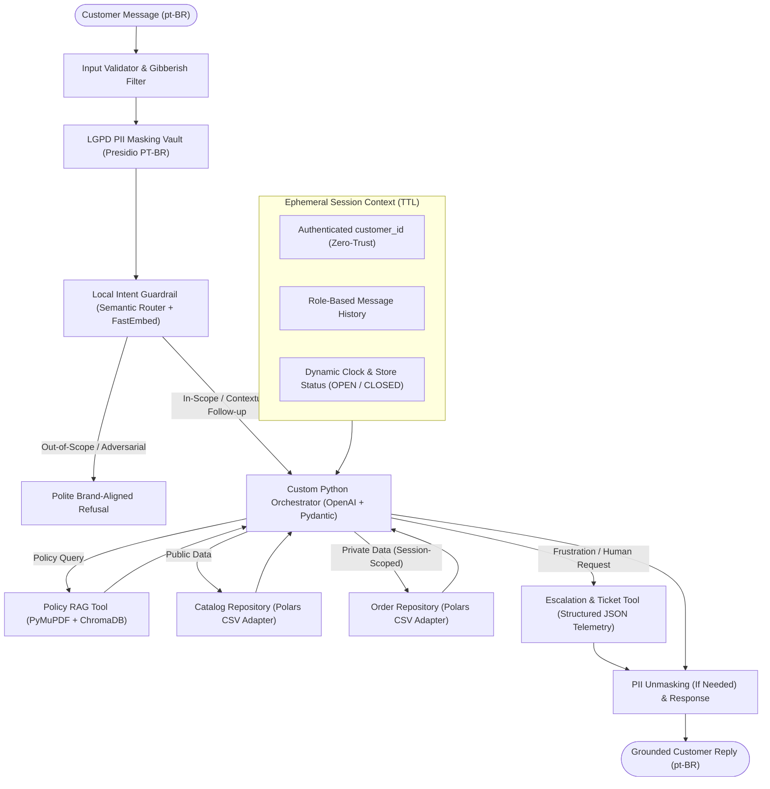

# Empório da Música — Conversational AI Customer Support Agent

[](https://www.python.org/downloads/)
[](./LICENSE)
[](https://github.com/astral-sh/ruff)

A high-control, privacy-first conversational AI agent built in Python to handle customer support for **Empório da Música** (a musical instruments and audio equipment store). Developed as an AI Engineering project for **Artefact**.

---

## Overview

The **Empório da Música** agent handles customer text messages in Brazilian Portuguese (`pt-BR`) while keeping its entire engineering codebase, orchestration logic, prompts, and documentation in English.

Instead of relying on opaque Low-Code platforms or heavy abstraction frameworks (`LangChain` / `LangGraph`), this project implements a **transparent, deterministic orchestration architecture** directly atop the native `openai` SDK and `pydantic` v2—prioritizing security, debuggability, LGPD compliance, and Data Engineering best practices.

### Core Capabilities
- **Brand-Aligned Persona & Dynamic Awareness:** Adapts responses to *Empório da Música*'s identity while dynamically tracking current date, day of week, and live store operational status (`OPEN` vs. `CLOSED`).
- **Intelligent Tool Routing (JSON Function Calling):**
  - **Store Policies (RAG):** Answers questions on exchanges, warranties, business hours, and payment methods from PDF documents (`PyMuPDF` + `ChromaDB`).
  - **Structured Store & Order Data:** Queries product catalog availability/pricing and customer-specific order status from CSV datasets using `Polars` behind clean Repository interfaces.
  - **Sentiment-Aware Human Escalation & Ticketing:** Monitors customer tone (profanity, impatience, excessive repetition, or explicit requests) to immediately halt automated resolution, log structured telemetry reasons, and either transfer to a live agent (`OPEN`) or register a support ticket (`CLOSED`).
- **Local Semantic Guardrails:** Filters out-of-scope topics and adversarial prompts locally via `semantic-router` + `FastEmbed` before incurring external LLM latency or cost.
- **Zero-Trust Customer Isolation:** Binds customer identity strictly in the backend session layer—never exposing `customer_id` as an LLM-controllable parameter—making cross-customer data leakage (IDOR) architecturally impossible.
- **LGPD Privacy by Design:** Masks personal and financial PII (CPF, credit cards, bank/PIX details, phone numbers, emails) via `Microsoft Presidio` + custom Brazilian recognizers before any payload leaves the application boundary, paired with ephemeral in-memory session retention.

---

## Architecture



---

## Tech Stack

| Domain | Technology | Rationale |
| :--- | :--- | :--- |
| **LLM & Validation** | `openai`, `pydantic` v2 | Direct control over tool loops, token budgets, and strict JSON schemas without framework bloat |
| **Structured Data** | `polars` | Fast, strongly typed Rust/Arrow dataframe engine behind swappable Data Lake/Warehouse Repository interfaces |
| **PDF & Local RAG** | `pymupdf`, `chromadb` | High-fidelity PDF extraction and local vector retrieval over sanitized policy chunks |
| **Guardrails & Embeddings** | `semantic-router`, `fastembed` | Single shared multilingual ONNX embedding model in memory for both intent routing and RAG |
| **Privacy / LGPD** | `presidio-analyzer`, `presidio-anonymizer` | Extended with custom Brazilian `PatternRecognizer` rules (CPF checksum, BR phone, CEP, financial data) |
| **Quality & Testing** | `pytest`, `ruff` | Comprehensive security, PII, guardrail, invalid-input, and behavioral test suites |

---

## Repository Structure

```text
artefact-aiengineer-project/
├── AGENTS.md           # Engineering handbook, architecture rules, and agent workflow constraints
├── README.md           # Project overview and setup documentation
├── LICENSE             # MIT License
├── decisions/          # Architecture Decision Records (ADRs) documenting design trade-offs
├── documents/          # Knowledge base PDFs and structured CSV datasets
├── src/                # Core orchestrator, guardrails, privacy vault, repositories, and tools
└── tests/              # Automated test suite (valid, invalid, gibberish, IDOR security, LGPD)
```

---

## Architecture Decision Records (`decisions/`)

Key architectural trade-offs are documented in [`decisions/`](./decisions/):
- [ADR-0000: ADR Template](./decisions/0000-adr-template.md)
- [ADR-0001: Custom Python Orchestrator over LangChain/LangGraph](./decisions/0001-custom-orchestrator-over-langchain.md)
- [ADR-0002: LGPD Privacy by Design and Zero-Trust Customer Isolation](./decisions/0002-data-privacy-lgpd-and-zero-trust-isolation.md)
- [ADR-0003: Local Semantic Guardrails, Shared Multilingual Embeddings, and Polars Repositories](./decisions/0003-local-guardrails-rag-and-polars-stack.md)

---

## License

Distributed under the MIT License. See [`LICENSE`](./LICENSE) for details.
