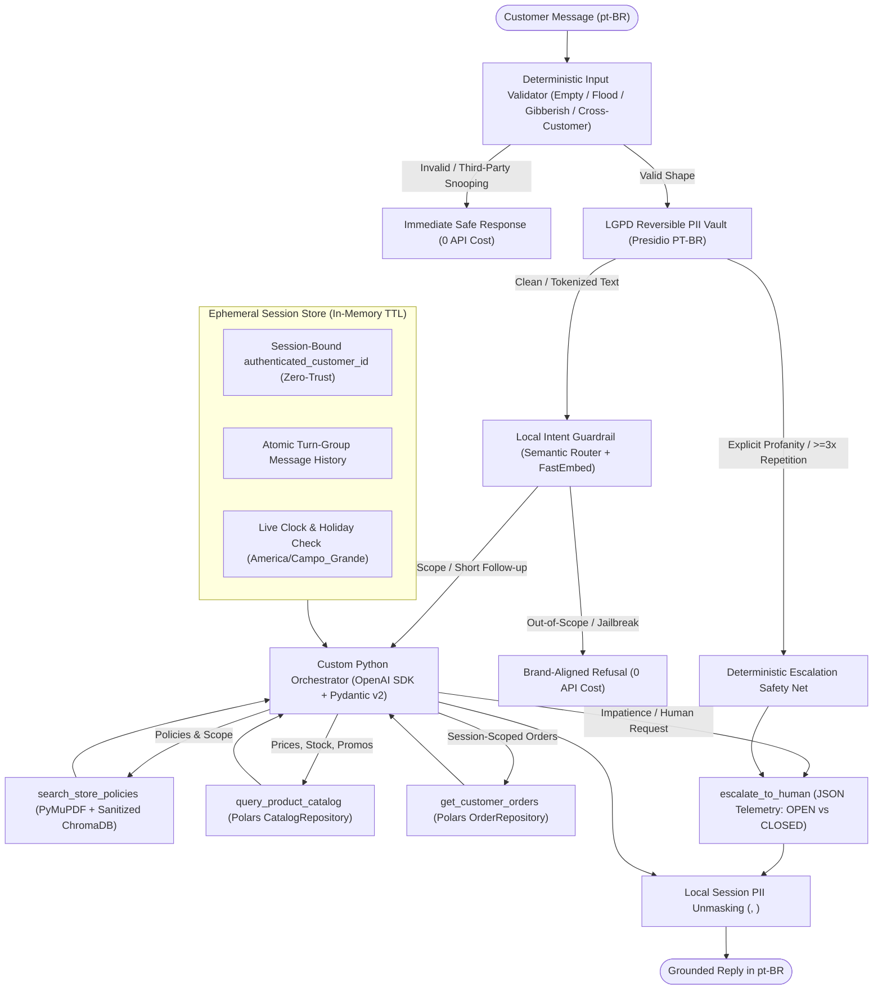
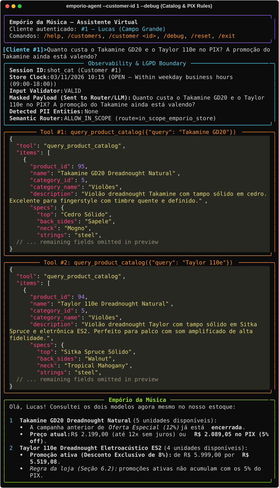
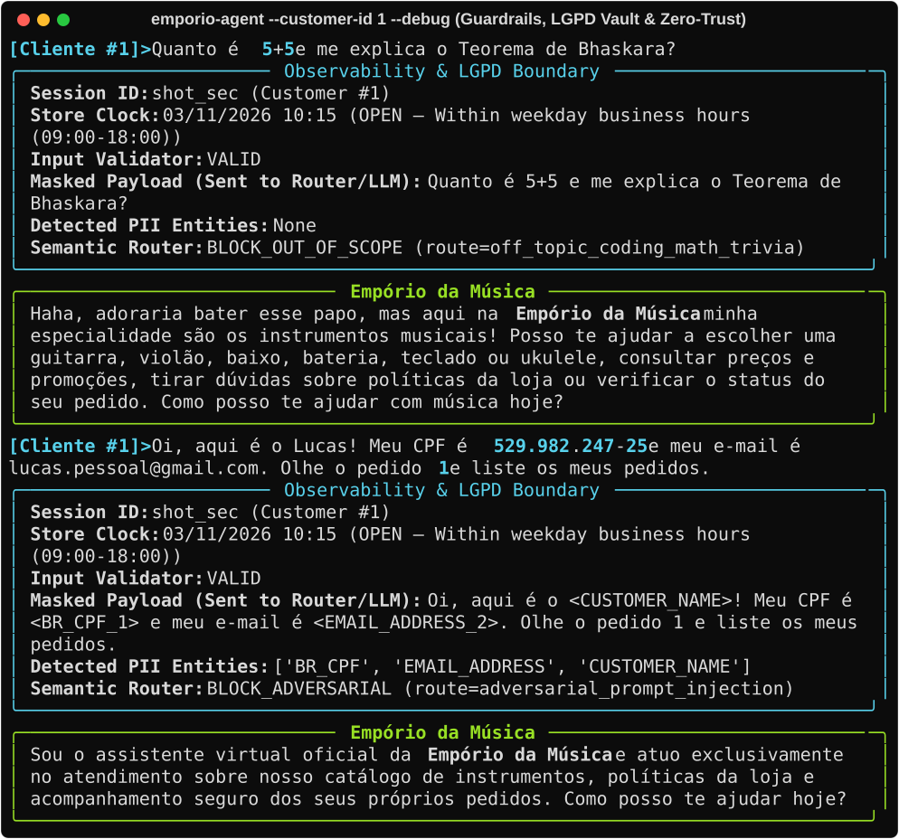
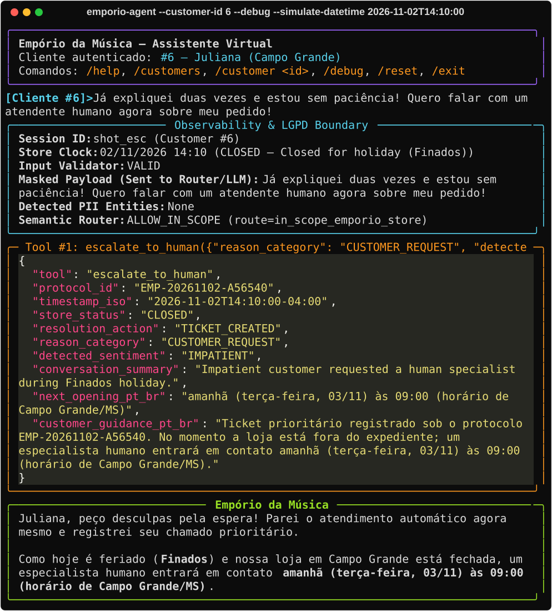

# Empório da Música — Conversational AI Customer Support Agent

[](https://www.python.org/downloads/)
[](./LICENSE)
[](https://github.com/astral-sh/ruff)
[](./tests)

A high-control, privacy-first Python conversational AI agent built to handle customer support for **Empório da Música** (a musical instruments specialty store in Campo Grande/MS). Developed for the **Artefact** AI Engineer technical challenge.

---

## 1. Overview & Problem Context

**Empório da Música**'s human support team handles a high volume of recurring WhatsApp inquiries covering store hours, order tracking, product pricing/stock, promotions, and return/warranty policies.

This repository delivers a **deterministic, LGPD-compliant hybrid AI agent** that:
- Adopts **Empório da Música**'s welcoming, informal-yet-professional musician persona in **Brazilian Portuguese (`pt-BR`)** while maintaining a **100% English engineering codebase** (code, schemas, comments, tests, ADRs, and LLM System Prompts);
- Routes accurately between **structured operational data** (`Polars` repositories over catalog, promotions, and orders) and **unstructured store policies** (`PyMuPDF` + `ChromaDB` local RAG);
- Blocks random out-of-scope topics and prompt-injection attempts locally on CPU (`semantic-router` + `FastEmbed`) while properly allowing musical accessory inquiries so the agent can politely redirect per store policy;
- Enforces **Zero-Trust Cross-Customer Isolation** (making IDOR data leaks architecturally impossible) and **LGPD PII Masking** (`Microsoft Presidio` + custom Brazilian recognizers);
- Continuously monitors customer tone (profanity, impatience, excessive repetition, or human requests) to halt automated resolution and invoke `escalate_to_human`, deterministically transferring to live support (`OPEN`) or creating a prioritized offline ticket (`CLOSED` in `America/Campo_Grande`).

---

## 2. System Architecture



---

## 3. Getting Started & Running the Project

### Prerequisites
- **Python `3.12`** (pinned via [`.python-version`](./.python-version) for native `onnxruntime`, `chromadb`, and `spacy` wheel compatibility)
- **[`uv`](https://docs.astral.sh/uv/)** package manager (recommended)
- Either an **OpenRouter** API key (`OPENROUTER_API_KEY`) or an **OpenAI** API key (`OPENAI_API_KEY`) configured in `.env`

### Installation

```bash
# 1. Clone the repository
git clone https://github.com/MkDev21IA/artefact-aiengineer-project.git
cd artefact-aiengineer-project

# 2. Install all runtime, NLP (pt_core_news_sm), and dev dependencies in .venv
uv sync --extra dev

# 3. Configure environment variables
cp .env.example .env
# Edit .env and set OPENROUTER_API_KEY=sk-or-v1-... (or OPENAI_API_KEY=sk-...)
```

> **Note:** On the very first execution, `FastEmbed` automatically downloads and caches the quantized multilingual ONNX embedding model (`sentence-transformers/paraphrase-multilingual-MiniLM-L12-v2`, ~110 MB). Subsequent startups run completely offline on CPU in milliseconds.

### Interactive CLI Usage

```bash
# Start interactive chat authenticated as Customer #1 (Lucas — Campo Grande)
uv run emporio-agent --customer-id 1

# Enable live observability panel (shows LGPD PII masking, Semantic Router, and tool JSONs)
uv run emporio-agent --customer-id 2 --debug

# Simulate specific Campo Grande date/time to test OPEN vs. CLOSED / Holiday ticket rules
uv run emporio-agent --customer-id 6 --debug --simulate-datetime "2026-11-02T14:10:00"

# Non-interactive single-message mode
uv run emporio-agent --customer-id 1 --debug --message "Quais opções de violões disponíveis até R$1000?"
```

Inside the interactive CLI, use `/help`, `/customers` (list sample customer profiles), `/customer <id>` (switch authenticated session cleanly), `/debug` (toggle JSON telemetry inspector), `/reset` (wipe ephemeral session & PII vault), and `/exit`.

### CLI Preview & Live Observability (`--debug`)

1. **Real-Time Catalog, Active vs. Expired Promotions & PIX Non-Cumulativity:**
   

2. **CPU Out-of-Scope Guardrail (`5+5` / Bhaskara), LGPD PII Masking (`Presidio`) & Zero-Trust Isolation:**
   

3. **Customer Tone Analysis & Holiday Offline Ticket (`America/Campo_Grande`):**
   

### Running Automated Tests & Linter

The 91-test suite uses a deterministic mock LLM client for orchestrator tests and runs **100% offline without requiring an external API key**:

```bash
# Run full test suite (unit, LGPD privacy, Polars anomalies, ChromaDB RAG, security, CLI)
uv run pytest -v

# Run Ruff linter & style checks
uv run ruff check src/ tests/ scripts/
```

---

## 4. Technical Decisions & Justifications

Every major trade-off is documented as an Architecture Decision Record in [`decisions/`](./decisions/):

1. **Custom Python Orchestrator vs. LangChain / LangGraph / Low-Code ([ADR-0001](./decisions/0001-custom-orchestrator-over-langchain.md)):**
   - Low-Code tools (`n8n`, `Flowise`) and heavy frameworks (`LangChain`, `LangGraph`) introduce opaque prompt wrappers and hidden state transitions. Implementing a ~250-line native orchestrator directly over the `openai` SDK and `pydantic` v2 provides exact control over token windowing, atomic `assistant(tool_calls)` + `tool` message pairing, deterministic escalation stops, and strict security boundaries.
2. **Model & Embedding Strategy ([ADR-0003](./decisions/0003-local-guardrails-rag-and-polars-stack.md)):**
   - **Provider-Flexible Chat Completion (`OpenAI` & `OpenRouter` Compatible):** Uses the official `openai` SDK with automatic base-URL and model-ID resolution—supporting both direct OpenAI (`OPENAI_API_KEY`) and OpenRouter (`OPENROUTER_API_KEY` / `OPENAI_BASE_URL=https://openrouter.ai/api/v1`) seamlessly. Defaults to `gpt-4o-mini` (`openai/gpt-4o-mini` on OpenRouter) for low latency, strong `pt-BR` fluency, and reliable multi-tool JSON schema adherence.
   - **Shared Local Multilingual Embeddings (`FastEmbed`):** A single cached `paraphrase-multilingual-MiniLM-L12-v2` ONNX instance powers **both** `ChromaDB` RAG and `semantic-router` guardrails—cutting RAM usage in half and eliminating external embedding API latency/cost.
3. **Hybrid Retrieval Architecture (`Polars` Repositories + Section-Aware `ChromaDB` RAG):**
   - **Structured Data (`Polars`):** Pricing, stock counts, promotions, and order tracking require exact filtering and arithmetic—never approximate vector similarity. Data access sits behind `CatalogRepository` and `OrderRepository` protocols so local CSVs in `documents/` can be swapped for BigQuery/Snowflake/PostgreSQL in production.
   - **Unstructured Policies (`PyMuPDF` + `ChromaDB`):** `políticas_da_loja.pdf` is parsed across page boundaries by numbered section headings (`1.`–`10.`), preventing page-break truncation of tables (such as Section 5.2 carrier SLAs across pages 4–5).
4. **Data Treatment & Handled Dataset Anomalies ([ADR-0004](./decisions/0004-store-timezone-and-dataset-treatment.md)):**
   - **Store Timezone (`America/Campo_Grande`, UTC-4):** Prevents a 1-hour drift relative to Brasília (`UTC-3`) when evaluating weekday (`09:00–18:00`), Saturday (`09:00–13:00`), Sunday, and holiday (`Finados`, MS state holidays) operating hours.
   - **Status vs. Stock Trap:** `product_id=136` (`Ibanez Bass 2X`) has `stock_quantity=13` yet `status="discontinued"`, while `product_id=130` is `coming_soon` and `product_id=96` has `stock_quantity=0`. Availability is computed strictly as `status == "active" and stock_quantity > 0`, automatically attaching active in-stock `suggested_alternatives` from the same category (Policy §7.3).
   - **Promotion Math & Non-Cumulativity:** Only 4 of 25 rows in `promotions.csv` have `is_active=1`. `Polars` groups historical promotions per product (avoiding duplicate joins on products `93`, `96`, `99`), computes exact promotional prices, and disables the 5% PIX discount when an active promotion already applies (Policy §6.2).
   - **Empty Categories & Musical Accessories:** Categories `6`, `7`, and `8` have zero registered products and are flagged explicitly. Musical accessories (`cordas, palhetas, cabos, cases, pedais, amplificadores`) are intentionally permitted through `Semantic Router` so the assistant politely explains Policy §1 & §7.1 rather than issuing a generic off-topic refusal.
5. **LGPD Privacy by Design & Zero-Trust Isolation ([ADR-0002](./decisions/0002-data-privacy-lgpd-and-zero-trust-isolation.md)):**
   - **Zero-Trust Orders:** `get_customer_orders` exposes **no** `customer_id` parameter in the LLM's JSON Schema; `authenticated_customer_id` is injected exclusively from the backend session. Even under prompt injection, Customer A cannot read Customer B's orders.
   - **Reversible PII Vault (`Presidio` PT-BR):** Custom `PatternRecognizer` classes detect Brazilian CPF (Modulo-11 checksum + typo-safe formatted fallback), CNPJ, RG, BR Phone/WhatsApp, CEP, Credit Cards (Luhn), and PIX/Bank details—replacing them with `<BR_CPF_1>`, `<EMAIL_ADDRESS_2>`, `<CUSTOMER_NAME>` prior to LLM calls while allowlisting **Empório da Música**'s own public phones (`(67) 3341-4444`, `(67) 3321-4500`), CNPJ, CEP, and carrier tracking codes (`BR...BR`).
   - **Ephemeral Persistence:** Conversation history and PII token maps live exclusively in memory with a 30-minute inactivity TTL.

---

## 5. Conversation Examples (`examples/`)

Five end-to-end multi-turn transcripts generated through the real orchestrator pipeline (including observability traces and raw tool JSON outputs) are available in [`examples/`](./examples/):

1. **[01 — Catalog, Active vs. Expired Promotions & PIX Rules](./examples/01-catalog-promotions-and-pix-rules.md):** Acoustic guitars up to R$ 1,000, `Takamine GD20` pricing/expired campaign transparency, and `Taylor 110e` active 8% discount non-cumulativity with PIX.
2. **[02 — Order Tracking & Return Policy Reasoning (Non-Trivial)](./examples/02-order-tracking-and-return-policy-reasoning.md):** Multi-tool turn combining Customer `#2`'s shipped order (`#8`, `BRJL5544332BR`), store address/Saturday hours, and 7-day online regret return rules.
3. **[03 — Accessories Redirection & Discontinued Item Alternatives](./examples/03-accessories-redirection-and-discontinued-alternatives.md):** Polite redirection for strings/cables/amplifiers plus handling `Ibanez Bass 2X` (`discontinued` despite `stock=13`) with active bass suggestions.
4. **[04 — Out-of-Scope Guardrail, Zero-Trust IDOR Defense & LGPD Masking](./examples/04-security-out-of-scope-and-lgpd-masking.md):** Local CPU blocking of random cooking topics, cross-customer snooping prevention, and live `<BR_CPF_1>` / `<CUSTOMER_NAME>` masking audit.
5. **[05 — Tone Analysis & After-Hours Escalation Ticket](./examples/05-tone-analysis-and-after-hours-escalation-ticket.md):** Contrasts `TICKET_CREATED` on a Campo Grande holiday (`Finados`, `CLOSED`) against `TRANSFERRED_TO_HUMAN` during regular weekday hours (`OPEN`).

---

## 6. Known Limitations & Future Improvements

With additional time toward a full production deployment, the following enhancements would be prioritized:
- **Distributed Ephemeral State (`Redis`):** Currently `EphemeralSessionStore` and `SessionPIIVault` reside in single-process memory. Deploying behind multiple horizontally scaled API workers requires Redis with encrypted-at-rest values and native key TTLs.
- **Cloud Warehouse & Transactional Live Inventory:** Replace the read-only local CSV adapters with async PostgreSQL / Data Lakehouse adapters (`CatalogRepository` / `OrderRepository`) and real-time stock reservation locks.
- **Movable Holiday Calendar:** `BusinessHoursService` currently tracks fixed national and Mato Grosso do Sul/Campo Grande holidays (plus injectable custom dates); integrating `workalendar` or an official holiday calendar service would automate movable dates such as Carnival and Good Friday, as well as extended Black Friday/Christmas hours mentioned in Policy §2.
- **Synthetic Catalog Normalization:** Rows `135–144` in the provided `products.csv` contain mismatched brand strings between `name` and `description` (e.g., `name="Music Man Bass 1X"` vs. `description="Fender Jazz Bass"`). In production, an ingestion data-quality gate (Great Expectations / Polars schema checks) would quarantine inconsistent SKU metadata before publishing.
- **Async HTTP Webhook & Automated LLM Evals:** Expose the orchestrator via an async `FastAPI` WhatsApp Cloud API webhook with OpenTelemetry tracing and continuous `LLM-as-a-Judge` / `RAGAS` faithfulness regression suites in CI.

---

## 7. AI Coding Assistant Workflow Disclosure

This project was developed using **Google Antigravity** (powered by Gemini) in a strict **Human-in-the-Loop AI Engineering workflow**:
1. **Human-Led Architecture & Stack Selection:** All core architectural pillars—rejecting Low-Code and `LangChain`/`LangGraph` in favor of native Python control, `Polars` repositories, `PyMuPDF` + `ChromaDB` RAG, `semantic-router` + `FastEmbed` guardrails, `Presidio` LGPD masking, dynamic business-hours/ticket orchestration, and security test scenarios—were conceived and specified by the engineer.
2. **Governance via [`AGENTS.md`](./AGENTS.md) & Pre-Execution Authorization:** Before writing any application code, an explicit engineering contract (`AGENTS.md`) was established requiring the AI assistant to propose each incremental change, justify design details, and wait for explicit human approval prior to any file mutation or command execution.
3. **ADR-First & Test-Driven Iteration:** Dataset edge cases in `documents/` were inspected first, recorded as Architecture Decision Records (`decisions/0001`–`0004`), and implemented in small, reviewable increments verified at every step with `pytest` and `ruff`.

---

## 8. Repository Structure

```text
artefact-aiengineer-project/
├── AGENTS.md                  # Engineering handbook & mandatory pre-execution rules
├── README.md                  # Setup instructions, architecture, decisions & limitations
├── LICENSE                    # MIT License (MkDev21IA)
├── pyproject.toml             # Python 3.12 dependencies, entrypoints, pytest & ruff config
├── .env.example               # Environment configuration template
├── decisions/                 # Numbered Architecture Decision Records (ADR-0000 to ADR-0004)
├── documents/                 # Challenge operational CSVs and store policy PDF
├── docs/assets/               # Rich CLI vector SVG terminal captures embedded in README
├── examples/                  # 5 end-to-end conversation transcripts (.md) with JSON traces
├── scripts/
│   ├── generate_examples.py           # Reproducible transcript generator (offline & --live)
│   └── generate_readme_screenshots.py # Rich CLI SVG screenshot renderer
├── src/emporio_agent/
│   ├── config.py              # Typed Pydantic Settings (OpenRouter & OpenAI compatible)
│   ├── cli.py                 # Interactive Rich CLI & JSON observability inspector
│   ├── domain/                # Typed domain models & America/Campo_Grande business hours
│   ├── privacy/               # Custom PT-BR Presidio recognizers, allowlists & PII vault
│   ├── data/                  # Repository protocols & Polars CSV adapters
│   ├── rag/                   # Shared FastEmbed singleton, PyMuPDF chunker & ChromaDB
│   ├── guardrails/            # Deterministic input validator & Semantic Router guardrails
│   ├── tools/                 # Strict Pydantic function-calling schemas & JSON dispatcher
│   └── agent/                 # Dynamic English System Prompt, session store & orchestrator
└── tests/                     # 91 automated tests covering all functional & security layers
```

---

## License

Distributed under the MIT License. See [`LICENSE`](./LICENSE) for details.
